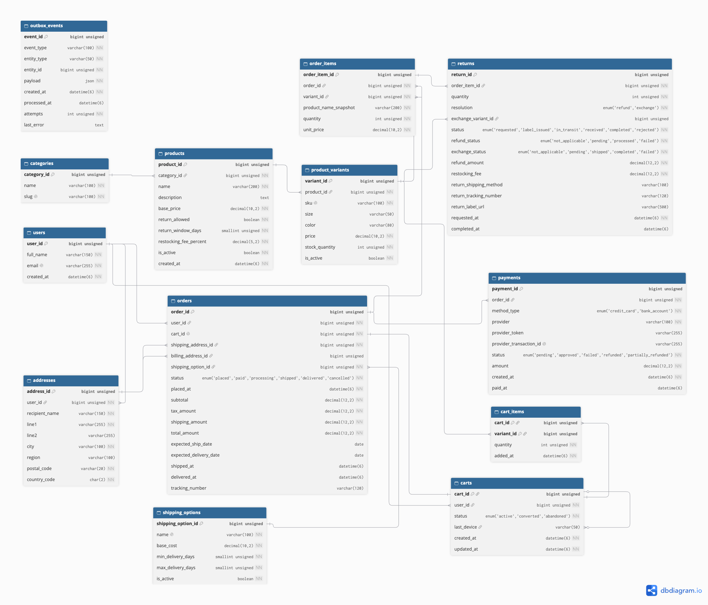

# Part 1: Database Design

## Helpful Information:

- **MySQL:** Stores transactional data (users, products, variants, carts, orders, payments, returns) because of relational integrity and ACID transactions.
- **MongoDB:** Stores flexible category-specific product attributes and high-volume user behavior events.
- **Redis:** Provides fast session management, recently viewed products, and cart/inventory caching. MySQL remains authoritative for carts and stock.
- **Neo4j:** Models user, order, product, and category relationships for co-purchase analysis and recommendations.
- **Product variants:** Each size/color combination has its own SKU and stock quantity in MySQL.
- **Cross-device carts:** Carts are linked to user IDs in MySQL and cached in Redis, so they persist across devices and sessions.
- **Synchronization:** MySQL uses a transactional outbox to propagate changes to Redis and Neo4j. MongoDB views are periodically aggregated into Neo4j.
- **Denormalization:** Order items preserve historical prices, while Redis caches improve read performance at the cost of additional synchronization.
- **Security:** Payment provider tokens are stored instead of full card numbers; all databases share consistent identifiers.

## Database Choice Per Feature

Our ecommerce platform leverages four databases, each assigned to the features that provide the best data shape and access pattern. MySQL (8.0) records anything involving accounts, money, stock, or order history because those features operate through transactions and are connected via foreign keys. MongoDB (8.0) stores diversely structured (category-specific product attributes) data or high volume data (behavior events). Redis (7.4) handles small, frequently accessed data that must load instantly like sessions, cart cache, and recently viewed items. Neo4j holds relational data between users, orders, products, and categories for co-purchase and recommendation questions. Redis and Neo4j only hold derived data meaning every stored value can be recreated from MySQL or MongoDB. Each database shares  the same keys (i.e. user_id, product_id, variant_id, etc.) so a record in one store can be matched directly to related records in the others.

| # | Design Feature | Database type | Product | Reasoning |
|---|---|---|---|---|
| 1 | User accounts and login | Relational | MySQL | Users are referenced by carts, orders, addresses and payments. Each foreign key ensures no order or cart points to a user that doesn't exist. Duplicate accounts are prevented by using the UNIQUE constraint of the user email field. |
| 2 | Categories and product catalogs | Relational | MySQL | All products share the same core fields, so they use a fixed schema. Each product belongs to a category by foreign key while a unique slug determines how category queries find products. Variants and order items also reference products by foreign key. The return rules (return_window_days, restocking_fee_percent) are stored with the product so a return can be priced correctly. |
| 3 | Category-specific specifications | Document | MongoDB | The product_attributes collection stores one document per product, with that product's category-specific specifications in an attributes object. Because each category has a different set of attributes, using MySQL it would result in many NULL columns, a table per category, or entity-attribute-value joins. A document stores each product's attributes as a nested object so new categories don’t need schema migration. |
| 4 | Product variants and their associated  stock | Relational | MySQL | Each size/color combination is stored in its own Stock Keeping Unit (SKU) row in product_variants with its own stock_quantity. At checkout, stock would be decremented with a conditional update  inside the same transaction that creates the order to prevent two shoppers from buying the same last unit. |
| 5 | Real-time stock counter | Key-value | Redis | Stock counts are read on every product page view but change infrequently, so the current count for each variant is cached in Redis as stock:{variant_id}. It is display-only so only MySQL decides whether a sale goes through. After each committed stock change the key is deleted and reloaded from MySQL on the next read. Also, the 24-hour expiration time window limits how stale it can get. |
| 6 | Recently viewed items | Key-value | Redis | A sorted set called recent:{user_id}, keyed on view time, returns the latest products in one command instead of scanning the event log. It keeps the 50 most recent views per user and expires after 30 days without activity. If the key is missing, the data is read from MongoDB view events, which contains the full history. |
| 7 | Cross-device session recognition | Key-value | Redis | Sessions are read on every request and are temporary, so they belong in memory. session:{id} is a hash holding the user_id and device, written together with a 7-day expiration window so stale sessions auto-delete. Each device gets its own session and points to the same user_id. |
| 8 | Persistent shopping cart | Relational | MySQL | Each cart and its data is keyed by user_id instead of temporary states like device or session, so it survives a device switch and an expired session. Cart objects are also kept after they're abandoned or converted, both for conversion analysis and because orders link back to the cart they came from. |
| 9 | Active cart cache on login | Key-value | Redis | The cart cache found by cart:{user_id} stores the active cart's items, prices and last-used device as JSON, so it loads instantly on any device. However,  MySQL stays the source of truth as every cart change writes an outbox event that rebuilds the cache from MySQL, and the key is deleted once the cart converts or is abandoned. |
| 10 | Visualization and Images | Document | MongoDB (image files in object storage) | Visualization data (dimensions and an object to compare against) is nested and only applies to some categories, so it is stored as an optional field in the product's MongoDB document. Images are stored as a list of URLs because the files themselves belong in an object store or a CDN, not a document database. |
| 11 | Cart review: quantities, removal, cost breakdown | Relational | MySQL | Cart totals come from cart_items joined with current variant prices. At checkout, the order records subtotal, tax_amount, shipping_amount and total_amount.  The total is validated through a CHECK constraint which guarantees it equals the sum of its parts. |
| 12 | Shipping options with expected dates | Relational | MySQL | Shipping options (Standard, Express, and Overnight) are stored in a small reference table holding cost and min/max delivery days with every order referencing one by foreign key. The order stores its expected ship and delivery dates for the confirmation, plus tracking and actual delivery times. |
| 13 | Payment methods and processing | Relational | MySQL | Payments belong in the same transaction as the order, so an order can't exist without its charge. Each payment records the method type, the provider's token and its transaction ID, which is unique, so a charge can't be recorded twice. |
| 14 | Order confirmation and history | Relational | MySQL | Orders and previously ordered items are permanent financial records stored by joining orders and order_items. Each order item stores the product name, variant_id, and unit price at the time of purchase, so later catalog changes don't alter past orders. |
| 15 | Returns | Relational | MySQL | Each return is tied to the exact item sent back, and records how many units were returned, so a user can return part of an order. If the user chooses an exchange, the return also points to the replacement item. It also stores the shipping label, shipping method and tracking number. Refunds and any restocking fees are calculated from the price paid and that product's restocking fee percentage. |
| 16 | Return status updates ("keeps her informed") | Relational | MySQL | Each return records where it is in the process: requested, label issued, in transit, received, completed or rejected. Refunds and exchanges are tracked separately, so customers can see both where their package is and whether their money or replacement is on its way. Status changes would be saved in the same transaction as the refund payment, so they can never go out of sync. |
| 17 | Behavior tracking | Document | MongoDB | Events arrive constantly, are never edited, and carry different fields by type: a search stores the search term, while a product view stores the time spent on the page. MongoDB handles this high write volume and stores each event type in its own shape without empty columns. Its aggregation pipeline can count and group events directly. |
| 18 | Co-purchase analysis and recommendations | Graph | Neo4j | Finding products bought together means following links from a product to the orders that contain it, then to the other products in those orders. In Neo4j this is a short, direct traversal. In SQL it needs order_items joined to itself, which gets slower as the number of orders grows. |
| 19 | User-product interest from browsing | Graph | Neo4j | Raw view events stay in MongoDB. They are periodically summarized into a single VIEWED relationship per user and product, which stores the view count and the last view time. This keeps the graph small while still supporting recommendations for applications like collaborative filtering. |
| 20 | Syncing Stores | Relational | MySQL | Any change to a cart, stock level, product or order must also insert a row into outbox_events within the same MySQL transaction. A background worker (sync.py) reads these rows and applies each change to Redis or Neo4j. A failed row is recorded with its error and retried on the next run. Because the outbox row commits or rolls back together with the change, an update can never be saved in MySQL but missed by the other stores. Redis and Neo4j may just lag slightly behind until the worker runs. |

## ERD Diagram 

ERD of the MySQL schema:

