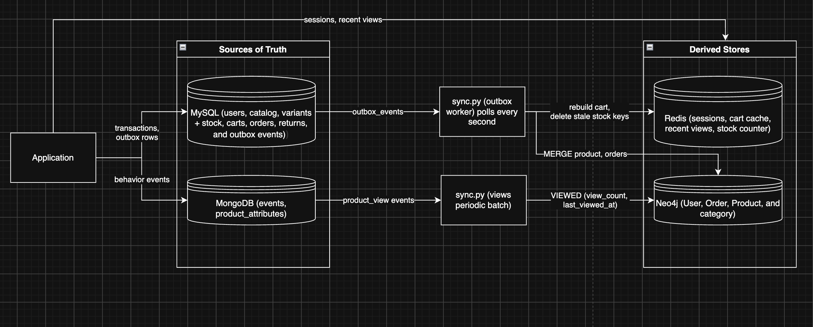
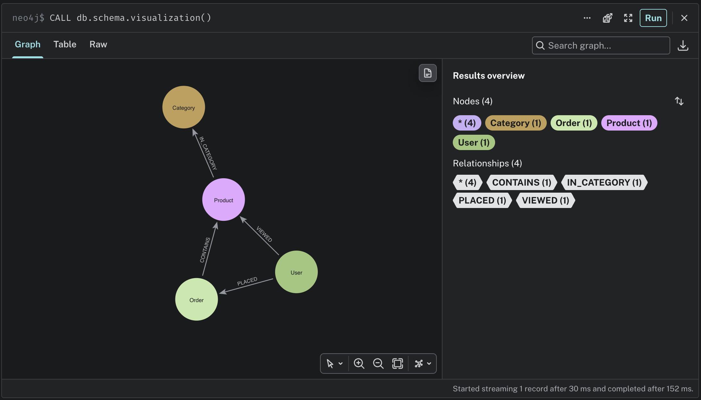

# Part 1: Database Design

<!-- 
## Helpful Information:

- **MySQL:** Stores transactional data (users, products, variants, carts, orders, payments, returns) because of relational integrity and ACID transactions.
- **MongoDB:** Stores flexible category-specific product attributes and high-volume user behavior events.
- **Redis:** Provides fast session management, recently viewed products, and cart/inventory caching. MySQL remains authoritative for carts and stock.
- **Neo4j:** Models user, order, product, and category relationships for co-purchase analysis and recommendations.
- **Product variants:** Each size/color combination has its own SKU and stock quantity in MySQL.
- **Cross-device carts:** Carts are linked to user IDs in MySQL and cached in Redis, so they persist across devices and sessions.
- **Synchronization:** MySQL uses a transactional outbox to propagate changes to Redis and Neo4j. MongoDB views are periodically aggregated into Neo4j.
- **Denormalization:** Order items preserve historical prices, while Redis caches improve read performance at the cost of additional synchronization.
- **Security:** Payment provider tokens are stored instead of full card numbers; all databases share consistent identifiers. -->


## Database Choice Per Feature

Our ecommerce platform leverages four databases, each assigned to the features that provide the best data shape and access pattern. MySQL (8.0) records anything involving accounts, money, stock, or order history because those features operate through transactions and are connected via foreign keys. MongoDB (8.0) stores diversely structured (category-specific product attributes) data or high volume data (behavior events). Redis (7.4) handles small, frequently accessed data that must load instantly like sessions, cart cache, and recently viewed items. Neo4j holds relational data between users, orders, products, and categories for co-purchase and recommendation questions. Redis and Neo4j only hold derived data meaning every stored value can be recreated from MySQL or MongoDB. Each database shares  the same keys (i.e. `user_id`, `product_id`, `variant_id`, etc.) so a record in one store can be matched directly to related records in the others.

| # | Design Feature | Database type | Product | Reasoning |
|---|---|---|---|---|
| 1 | User accounts and login | Relational | MySQL | Users are referenced by carts, orders, addresses and payments. Each foreign key ensures no order or cart points to a user that doesn't exist. Duplicate accounts are prevented by using the `UNIQUE` constraint of the user email field. |
| 2 | Categories and product catalogs | Relational | MySQL | All products share the same core fields, so they use a fixed schema. Each product belongs to a category by foreign key while a unique slug determines how category queries find products. Variants and order items also reference products by foreign key. The return rules (`return_window_days`, `restocking_fee_percent`) are stored with the product so a return can be priced correctly. |
| 3 | Category-specific specifications | Document | MongoDB | The `product_attributes` collection stores one document per product, with that product's category-specific specifications in an `attributes` object. Because each category has a different set of attributes, using MySQL it would result in many NULL columns, a table per category, or entity-attribute-value joins. A document stores each product's attributes as a nested object so new categories don’t need schema migration. |
| 4 | Product variants and their associated  stock | Relational | MySQL | Each size/color combination is stored in its own Stock Keeping Unit (SKU) row in `product_variants` with its own `stock_quantity`. At checkout, stock would be decremented with a conditional update  inside the same transaction that creates the order to prevent two shoppers from buying the same last unit. |
| 5 | Real-time stock counter | Key-value | Redis | Stock counts are read on every product page view but change infrequently, so the current count for each variant is cached in Redis as `stock:{variant_id}`. It is display-only so only MySQL decides whether a sale goes through. After each committed stock change the key is deleted and reloaded from MySQL on the next read. Also, the 24-hour expiration time window limits how stale it can get. |
| 6 | Recently viewed items | Key-value | Redis | A sorted set called `recent:{user_id}`, keyed on view time, returns the latest products in one command instead of scanning the event log. It keeps the 50 most recent views per user and expires after 30 days without activity. If the key is missing, the data is read from MongoDB view events, which contains the full history. |
| 7 | Cross-device session recognition | Key-value | Redis | Sessions are read on every request and are temporary, so they belong in memory. `session:{id}` is a hash holding the `user_id` and device, written together with a 7-day expiration window so stale sessions auto-delete. Each device gets its own session and points to the same `user_id`. |
| 8 | Persistent shopping cart | Relational | MySQL | Each cart and its data is keyed by `user_id` instead of temporary states like device or session, so it survives a device switch and an expired session. Cart objects are also kept after they're abandoned or converted, both for conversion analysis and because orders link back to the cart they came from. |
| 9 | Active cart cache on login | Key-value | Redis | The cart cache found by `cart:{user_id}` stores the active cart's items, prices and last-used device as JSON, so it loads instantly on any device. However,  MySQL stays the source of truth as every cart change writes an outbox event that rebuilds the cache from MySQL, and the key is deleted once the cart converts or is abandoned. |
| 10 | Visualization and Images | Document | MongoDB (image files in object storage) | Visualization data (dimensions and an object to compare against) is nested and only applies to some categories, so it is stored as an optional field in the product's MongoDB document. Images are stored as a list of URLs because the files themselves belong in an object store or a CDN, not a document database. |
| 11 | Cart review: quantities, removal, cost breakdown | Relational | MySQL | Cart totals come from `cart_items` joined with current variant prices. At checkout, the order records `subtotal`, `tax_amount`, `shipping_amount` and `total_amount`.  The total is validated through a `CHECK` constraint which guarantees it equals the sum of its parts. |
| 12 | Shipping options with expected dates | Relational | MySQL | Shipping options (Standard, Express, and Overnight) are stored in a small reference table holding cost and min/max delivery days with every order referencing one by foreign key. The order stores its expected ship and delivery dates for the confirmation, plus tracking and actual delivery times. |
| 13 | Payment methods and processing | Relational | MySQL | Payments belong in the same transaction as the order, so an order can't exist without its charge. Each payment records the method type, the provider's token and its transaction ID, which is unique, so a charge can't be recorded twice. |
| 14 | Order confirmation and history | Relational | MySQL | Orders and previously ordered items are permanent financial records stored by joining `orders` and `order_items`. Each order item stores the product name, `variant_id`, and unit price at the time of purchase, so later catalog changes don't alter past orders. |
| 15 | Returns | Relational | MySQL | Each return is tied to the exact item sent back, and records how many units were returned, so a user can return part of an order. If the user chooses an exchange, the return also points to the replacement item. It also stores the shipping label, shipping method and tracking number. Refunds and any restocking fees are calculated from the price paid and that product's restocking fee percentage. |
| 16 | Return status updates ("keeps her informed") | Relational | MySQL | Each return records where it is in the process: requested, label issued, in transit, received, completed or rejected. Refunds and exchanges are tracked separately, so customers can see both where their package is and whether their money or replacement is on its way. Status changes would be saved in the same transaction as the refund payment, so they can never go out of sync. |
| 17 | Behavior tracking | Document | MongoDB | Events arrive constantly, are never edited, and carry different fields by type: a search stores the search term, while a product view stores the time spent on the page. MongoDB handles this high write volume and stores each event type in its own shape without empty columns. Its aggregation pipeline can count and group events directly. |
| 18 | Co-purchase analysis and recommendations | Graph | Neo4j | Finding products bought together means following links from a product to the orders that contain it, then to the other products in those orders. In Neo4j this is a short, direct traversal. In SQL it needs `order_items` joined to itself, which gets slower as the number of orders grows. |
| 19 | User-product interest from browsing | Graph | Neo4j | Raw view events stay in MongoDB. They are periodically summarized into a single `VIEWED` relationship per user and product, which stores the view count and the last view time. This keeps the graph small while still supporting recommendations for applications like collaborative filtering. |
| 20 | Syncing Stores | Relational | MySQL | Any change to a cart, stock level, product or order must also insert a row into `outbox_events` within the same MySQL transaction. A background worker (`sync.py`) reads these rows and applies each change to Redis or Neo4j. A failed row is recorded with its error and retried on the next run. Because the outbox row commits or rolls back together with the change, an update can never be saved in MySQL but missed by the other stores. Redis and Neo4j may just lag slightly behind until the worker runs. |

## ERD Diagram 

ERD of the MySQL schema:


## Varying Product Attributes and Variants

Each category describes its product attributes differently. For example, the dress category includes attributes like material, style, and care instructions while the headphones category contains attributes like battery life, connectivity, and weight. While determining the best way to store diverse attributes across categories, we considered the following approaches and outlined their pros and cons.

| Approach | Method | Pros | Cons |
|---|---|---|---|
| Table per category | A separate table for each category's attributes (e.g. `headphone_specs`, `dress_specs`) | Strict data types and constraints | Every new category needs a new table and schema expansion. Also listing products across categories requires combining many tables |
| Entity-attribute-value (EAV) | One table with a row per attribute: `(product_id, attribute_name, value)` | Any attribute can be added without changing the schema | Each attribute needs its own join, so queries are slow and hard to read |
| JSON column in MySQL | A single JSON column listing attributes on the `products` table | Information doesn’t split between databases | Nested JSON fields are harder to validate and index. Also a pure JSON column makes the product table much heavier |
| Document store (MongoDB) | One document per product with its attributes stored as a nested object | Each category keeps its own natural shape. Nested fields can be indexed and new categories can be added without migration | Product-specific information is split between MySQL and MongoDB so the business logic must combine reads from both databases. |

We ultimately chose to use the MongoDB document store. The `product_attributes` collection stores one document per product, linked to MySQL through a shared `product_id`. Leveraging the document data format, each product category stores attributes in the shape that fits them so adding a new category doesn’t require a schema change. The main drawback is that a complete product view must combine data from MySQL and MongoDB in the application code to get the full view of a product to purchase.

Variants are what is actually sold and stocked so each size and color combination is its own row in `product_variants`, with a unique stock keeping unit (`sku`), unit price, and `stock_quantity`. For instance, a dress offered in three sizes and two colors has six rows, each tracking its own stock. Keeping variants in MySQL means stock can be reduced in the same transaction that creates an order. Indexing on `(color, stock_quantity)` and `(size, stock_quantity)` makes availability searches like "blue or size Large" (Task 4) and low-stock checks (Task 3) relatively fast.

## Session Management

Sessions are stored in Redis because they are read on every request, are temporary, and are safe to lose. When a user logs in, the platform would create a key `session:{session_id}`: a hash holding the `user_id` and the device type (laptop, tablet or phone). The fields and a 7-day expiration are written together in a single Redis transaction, so stale sessions delete themselves. Each device gets its own session, but every session points to the same `user_id`. That is how the platform recognizes Sarah as the same customer whether she starts on her tablet or returns hours later on her laptop.

At the same time, the cart is tied to the user, not to the session or device, which is why it can survive a device switch or an expired session. In this case, MySQL is the source of truth as the `carts` table stores each cart's `user_id`, its status (active, converted or abandoned) and its last-used device. Meanwhile, `cart_items` stores each variant and quantity. For fast loading, Redis caches the active cart as `cart:{user_id}`, a JSON value with the items, prices and last device, which also expires after 7 days. When Sarah logs in on her laptop, the platform would read her `user_id` from the new session and load `cart:{user_id}`. If the key has expired, it would be rebuilt from her active cart in MySQL. Every cart change would write an outbox event, which the sync worker uses to refresh the cache from MySQL. At checkout, the cart would be marked as converted, the new order references it through `cart_id`, and processing the order event deletes the cached key.

## Denormalization

Our schema denormalizes product names into order items. In a fully normalized design, an order item would store only its `variant_id`, and showing the product's name would require joining `order_items` to `product_variants` and then to `products`. Instead, when an order is placed, the product's name is copied into `order_items.product_name_snapshot`. Order history and returns are viewed often and always display product names, so keeping the name next to the order item avoids those extra joins. The copy also acts like a receipt. In the case that a product is renamed later, past orders still show the name the customer saw when they bought it.

- Reads: pages that show past orders, like order history (Task 8) and returns (Task 9), can read the product name straight from `order_items` without looking it up in `products`. Also, both tasks run in under 1 ms.
- Writes: one extra column is written per order item at checkout. The name is written once and never updated, so the cost is negligible.
- Consistency: the copy can differ from the current catalog name. That is intended for historical records if the product name changes. The current name is still available through `variant_id` when needed.
- Storage: each order item carries a short string  of up to 200 characters. Across the generated data this adds only a few megabytes, which is small compared to the joins it saves.


## Data Flow

Data flow diagram:



MySQL and MongoDB are the sources of truth as they are directly written too. Redis and Neo4j only hold derived data meaning that they are filled from MySQL through the outbox worker and from MongoDB through a periodic batch job. However, sessions and recently viewed items are the exception, since the application writes them straight to Redis. Decisions about money and stock are always made in MySQL, so a short delay in the derived stores never affects correctness.

| Data | How it gets there | Expected freshness | Read latency (measured) |
|---|---|---|---|
| Orders, stock, carts, payments, returns (MySQL) | Written directly in transactions | Immediate | Under 1 ms for single user queries (Tasks 8–10) |
| Behavior events (MongoDB) | Written as each interaction happens | Real time, however analytics can tolerate a few seconds of delay | 0.6 ms (Task 6) to 69 ms (Task 5) |
| Sessions, recently viewed (Redis) | Written directly by the application | Real time | About 1 ms (Task 2) |
| Cart cache, stock counter (Redis) | Outbox worker, polling every second | About 1–2 seconds behind MySQL | Not measured but should be single-key lookups |
| Products and orders graph (Neo4j) | Outbox worker | About 1–2 seconds behind MySQL | 126 ms (Task 12) |
| VIEWED relationships (Neo4j) | Periodic batch from MongoDB | Minutes to hours, depending on how often the batch runs. | Not measured separately |


## Challenges

Our design has four main risk areas. Payment security is listed first, since it carries the most weight.

| Challenge | Significance | Mitigation |
|---|---|---|
| Payment data security | Storing card numbers would put the whole database in PCI DSS scope and make a breach catastrophic. | Customers would type their card details into the payment provider's own form, so the card number never reaches our servers. The `payments` table stores only the provider's token, its transaction ID and the method type. It never stores sensitive information like card numbers or CVVs. Also, tokens are useless outside our merchant account. The payment data is never written to MongoDB events or logs. In production, the database would be encrypted at rest and connections would use TLS. |
| Keeping four stores consistent | A change saved in MySQL could fail to reach Redis or Neo4j, leaving stale or wrong data. | Every change in MySQL also writes a row to `outbox_events` in the same transaction, so the change and its sync instruction are saved together or not at all. The sync worker then rebuilds the affected data from MySQL's current state, so processing the same event twice has no negative impact. |
| Failed sync events retry forever | A permanently broken event would be retried on every run. | Set a maximum number of retries. Once an event reaches it, move the event to a separate "failed events" table and alert the team to investigate, instead of retrying it indefinitely. |
| Stale cache data | A shopper could see an outdated stock count or cart. | Redis is only used for display. At checkout, MySQL makes the final stock check, so a stale count can't cause a bad sale. Also, cached keys are deleted after each change and expire on their own (24 hours for stock, 7 days for carts). |

## In-Memory Storage

Redis holds data that is read on nearly every page and must load instantly, but is small and safe to rebuild. MySQL and MongoDB must stay the sources of truth, so keeping Redis consistent comes down to one rule: when the main data changes, update or delete the Redis copy, and let every key expire as a safeguard.

| Data | Redis structure | Why in memory | How it stays consistent |
|---|---|---|---|
| Sessions | `session:{session_id}`, contains a hash of `user_id` and device | Checked on every request | Redis is the only copy. Sessions expire after 7 days and losing one just means logging in again. |
| Active cart | `cart:{user_id}`, JSON of items, prices and last device | Loads the cart instantly on any device | A `cart_updated` outbox event rebuilds it from MySQL while placing an order deletes it. It expires after 7 days and would be rebuilt from MySQL when missing. |
| Recently viewed | `recent:{user_id}`, a sorted set scored by view time | Shown the moment a user opens a category | Written together with each MongoDB view event. It expires after 30 days, and if it's missing, the data can be read from MongoDB. |
| Stock counter | `stock:{variant_id}` | Shown on every product page | Deleted after each stock change or order and reloaded from MySQL on the next read. It expires after 24 hours. It’s also only used for display so MySQL makes the real stock check at checkout. |

Strategies to stay consistent:

- **Delete rather than update:** Deleting a stale key forces the next read to fetch fresh data from MySQL.
- **Sync through the outbox:** Changes reach Redis through the outbox worker, which polls every second, so Redis may lag MySQL by only a second or two.
- **Expiration times as a backstop:** Every key expires, so even a missed update can only be stale for a limited time.

## Behavior Tracking

### Behavior Tracking Architecture

Behavior data is high-volume, append-only and varied, so it lives in MongoDB, separate from MySQL's transactional data. Every interaction (a product view, click, search or cart action) is stored as one document in the `events` collection. Events are written once, never updated, and the application would send them in the background so tracking never slows down the shopping experience. Each event carries the same `user_id` and `product_id` used in MySQL, so behavior can be linked directly to users, products and orders.

### What an event looks like

All events share a common core (`event_id`, `user_id`, `session_id`, `event_type`, `occurred_at`, `device`), and each type adds only the fields it needs. A schema validator enforces the core fields and allows six event types: `product_view`, `product_click`, `search`, `cart_add`, `cart_remove` and `cart_update`.

Example JSON:

```json
{ "event_id": 48213, "user_id": 1, "session_id": "session-1-tablet", "event_type": "product_view", "product_id": 123, "device": "tablet", "duration_ms": 42000, "occurred_at": "2026-11-20T14:05:00Z" }
```

A search event would carry `search_term` instead of `product_id` and `duration_ms`. Also, optional fields simply don't exist on events that don't need them, so there are no empty columns.

### Indexes for the main access patterns

| Index | Used for |
|---|---|
| `event_id` (unique) | Prevents duplicate events if one is sent twice |
| `(user_id, event_type, occurred_at)` | One user's recent views or searches e.g. Sarah's searches in the last 30 days (Task 6, 0.6 ms) |
| `(event_type, product_id)` | View counts per product across all users (Task 5, 69 ms over 500,000 events) |

### Scalability

- **Summaries for fast reads:** raw events stay in MongoDB, while frequently read summaries live somewhere else. For instance, recently viewed items can be read from Redis, and view counts from Neo4j.
- **Old data is archived:** events older than 12 months are archived or removed with a TTL index, keeping the collection relatively small.
- **Writes can be spread out:** as volume grows, the collection can be sharded by `user_id` across servers.
- **Checkout isn't slowed down:** tracking writes go to MongoDB, so they never compete with MySQL transactions.

## Graph Model

### Overview

In a graph database, each record stores direct links to other connected records, so moving from one record to the next is a single step. A relational database has to rebuild those connections at query time with joins. That works well for one or two steps, but each extra step in a question needs another join, and the intermediate results grow larger with every join. In a graph, a query's cost depends only on the records it actually visits, not on how big the tables are. Below are some questions that a graph database can answer efficiently:

- **Co-purchase:** which products are most often bought together with headphones? (Task 12)
- **Collaborative filtering:** what did people who viewed this product go on to buy?
- **Similar customers:** which users bought many of the same products as Sarah, and what else did they buy?
- **Category affinity:** which categories tend to be bought together across many orders?

### Graph model

| Element | Type | Properties |
|---|---|---|
| `User` | Node | `user_id` (unique), `name` |
| `Product` | Node | `product_id` (unique), `name` |
| `Category` | Node | `category_id` (unique), `name`, `slug` |
| `Order` | Node | `order_id` (unique), `placed_at`, `status` |
| `(User)-[:PLACED]->(Order)` | Relationship | none |
| `(Order)-[:CONTAINS]->(Product)` | Relationship | `order_item_id`, `variant_id`, `quantity`, `unit_price` |
| `(Product)-[:IN_CATEGORY]->(Category)` | Relationship | none |
| `(User)-[:VIEWED]->(Product)` | Relationship | `view_count`, `last_viewed_at` |

### Design Choices

- **Orders are their own nodes.** Users link to orders, and orders link to products, rather than users linking straight to products. That lets the graph tell whether two products were bought in the same order, which co-purchase analysis needs.
- **Variants are stored on the `CONTAINS` relationship.** The size or color bought is a property there instead of a separate node, which keeps the graph smaller. Recommendations work at the product level, so variant nodes aren't needed.
- **Views are summarized.** Each user and product pair has a single `VIEWED` relationship holding a view count, instead of one relationship per view, so 500,000 raw events don't flood the graph.

### Implementation

Three files build and maintain the graph:

- **`schema/neo4j.cypher`** makes `user_id`, `order_id`, `product_id` and `category_id` unique, which also indexes them for fast lookups, and adds an index on category names.
- **`src/load.py`** builds the graph using the same IDs as MySQL. It uses `MERGE`, which only creates a node or relationship if it doesn't already exist, so reloading never creates duplicates. It also builds the `VIEWED` relationships by summarizing MongoDB view events.
- **`src/sync.py`** keeps the graph up to date: product and order changes arrive through the outbox, and a periodic batch refreshes the `VIEWED` relationships.

### Proof of Implementation

Model in Neo4j:



Node and Relationship Counts:

| Element | Type | Count |
|---|---|---|
| User | Node | 10,000 |
| Product | Node | 5,000 |
| Category | Node | 8 |
| Order | Node | 100,000 |
| PLACED | Relationship | 100,000 |
| CONTAINS | Relationship | 200,436 |
| IN_CATEGORY | Relationship | 5,000 |
| VIEWED | Relationship | 274,729 |